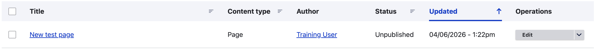
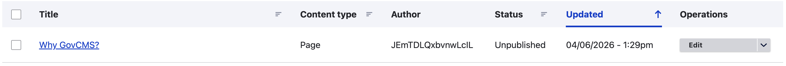

# Archiving vs unpublishing

Content on government websites should ideally never be deleted, to comply with government record-keeping practices.&#x20;

GovCMS provides you with two options to remove content from being publicly accessible.

While much of the functionality around this is part of the [Workflow module](https://app.gitbook.com/s/zAp101XNX82HnyCe3C9U/workflows) (which is covered later) it's important to understand the various content 'states' while we learn how to edit content.

### Unpublished or archived

When content is **Unpublished** it means either:

* There is no active published version of that page on the website
* The content has been archived

For example, below is the content item display for a brand new page saved in **Draft**. There is no published version of this page and it's **not accessible by the public**.

<figure><figcaption>
Status column shows Unpublished for newly drafted content
</figcaption></figure>

The same **Status** is also shown for pages that are **Archived**, which is a workflow state given to content that had been published but needs to be removed.

<figure><figcaption>
Status column shows Unpublished for an Archived page
</figcaption></figure>

When content is **Archived**, it still exists in the CMS (the change history and revision log is still there if anyone needs it) but it's no longer publicly accessible.

### Deleted

Deleting content **permanently** removes it from the website. Once deleted, the only way to recover it involves a full website backup restoration.

You should really only delete content if it was created by mistake or was never made public.
