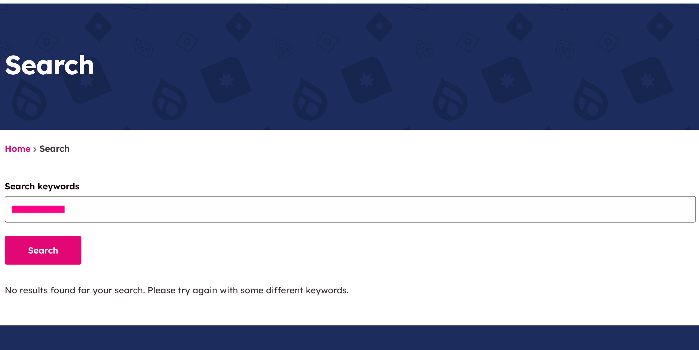

# Editing content

You can edit content in one of two ways:

*   By going to the **Content** screen and selecting the **Edit** button associated with the content you want to edit 

    <figure><figcaption></figcaption></figure>

    &#x20;
*   By viewing the content and then clicking the **Edit** button. 

    <figure><figcaption></figcaption></figure>

However there are some _edge cases_ where this doesn't always work.

### View or listing pages

**Views** and **listing pages** (such as the events page on your training site) show content on the page, however the page is actually only storing a reference to the content.

In the below example, if we selected the **Edit tab**, we wouldn't be able to actually edit the content in the cards because that content is stored in the events themselves. To edit the content, we'd need to go to the individual events.

Additionally the "Showing x - y of z" text is provided by a page template, and is not editable by a Content Author.

<figure><figcaption></figcaption></figure>

Other examples include the **No results behaviour** text that's shown when a **Search** page returns no results.

In the example below from the GovCMS website, the search has returned no results but that text can't be edited by simply clicking Edit on this page. Instead, a **developer** would need to update the search function.

If you find any text that you can't edit, please contact your developer for assistance.

<figure><figcaption>
Search page showing no results
</figcaption></figure>
