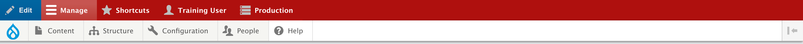
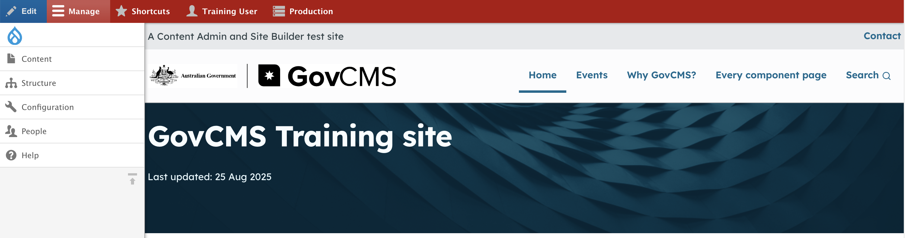

# Admin toolbar overview


The page has a video that explains the information located at the bottom of the page.


Once logged in, you'll see the **Admin toolbar** at the top of the website.

The colour of the top bar will change depending on what environment you're in.

* A <mark style="color:red;">**Red**</mark> bar shows you're on your **production** website that's live to the public.
* A <mark style="color:green;">**Green**</mark> bar shows you're on a **secondary** or **test** environment.

The **Admin toolbar** has two main subsections. **Manage** and **User**.

**Manage** contains your content and site administration options such as:

* **Content:** Manage all pages, media and revisions
  * **Media:** Access reusable images, documents and videos
* **Structure:** Menus and taxonomy (restricted actions for Content Authors)
* **Configuration:** System settings (not typically used by Content Authors)
* **People:** User management (usually Site Administrator access only)
* **Help:** Provides general Drupal-based Help that may not be relevant to GovCMS.

<figure><figcaption></figcaption></figure>

**User** contains shortcuts to your user account and is accessed by selecting your user name from the toolbar.

* **View profile**: Not used very much on government websites
* **Edit profile**: Allows you to change your username, email, password or reset your 2FA settings
* **Logout:** Logs you out of the website.

<figure><figcaption></figcaption></figure>

The Admin toolbar can also be set as a **Vertical** menu — select the button in the far right of the Manage submenu.

<figure><figcaption></figcaption></figure>

<figure><figcaption>
Admin toolbar showing as a vertical menu
</figcaption></figure>

### 🎥 Video



Video transcript

Welcome to the GovCMS Introduction to Content Management series.

In this video you'll learn about the Admin toolbar which will help you navigate through the GovCMS backend.

The admin menu gives you access to a variety of functions.

When you hover your mouse over the various menus in the admin toolbar (without actually clicking on any of these menus) most of them expand to reveal more options.

If you don't see more options when you hover over the menus, it means you just have the default Toolbar installed.

Please talk to your development partner and ask them to install the "Admin toolbar" module that comes with GovCMS.

Let's now go to a page which is a few levels deep.

Make sure "Manage" is expanded, and go to Structure, Content types, Standard page, Manage fields.

Don't worry about what's on this page, I just want to show you how to use the admin toolbar menus to access lower-level pages.

Depending on your account's level of permissions, you may see some menu items missing from the admin menu.

This is by design; it's not a flaw.

You'll only see menu items that your assigned roles have access to.

So if your user account doesn't have access to a page, you won't see a menu item for it.

To move between pages, you can use the back and forward buttons on your browser.

To demonstrate let's go to Content, Add content, Standard page.

If you want to go back, just click on the Back button, and likewise, if you want to go forward just click on the Forward button.

The admin toolbar, by default, is placed horizontally across the top of the page in the standard desktop view.

However, when on mobile view it automatically switches to a vertical display down the left-hand side of the screen.

Although the switch to this mobile mode happens automatically on smaller screen sizes, you can also manually trigger it and have the toolbar displayed on the left-hand side on the desktop view.

Simply click the vertical orientation button on the far right of the toolbar, and then it'll display vertically on the left-hand side.

When the toolbar is displayed vertically, the menus do not expand automatically when you hover over them.

You need to click on the downwards-pointing arrow to expand the next level.

Then if you want to collapse it, click on the up arrow button to close it.

To switch the toolbar back to the horizontal position, just click on the horizontal orientation button below the last menu item.

Let's now discuss the menu items under the Manage section in the toolbar.

First is Content —This is where you manage the site's content pages and files.

Second is Structure — This is where you can change structural configuration such as content types, blocks and much more.

Then there's Appearance — This is where developers can manage the site's theme, which controls how the site looks visually.

Then is Configuration — This area is usually only available to site admins.

Module and core configuration are controlled here.

And finally People — Where you can manage users, roles and permissions for GovCMS users.

Let's now recap what we covered in this video: You've learnt about the admin toolbar and all of the important admin menu items.

