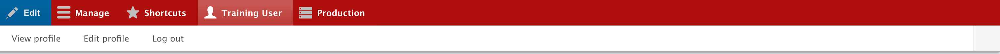

# Logging out


The page has a video that explains the information located at the bottom of the page.


Users can log out from a GovCMS website in several ways:

* Navigate to your website's URL and add **/user/logout**

or

*   Click on your username in the **Admin toolbar** and then select **Log out.** 

    <figure><figcaption></figcaption></figure>

Logging out will take you back to the homepage of your website. You can confirm you're logged out because the **Admin toolbar** will no longer be visible.

### 🎥 Video



Video transcript

Welcome to the GovCMS Introduction to Content Management series. In this video, you'll learn how to log out of a GovCMS website.

We'll cover the following two topics: how to log out of any GovCMS website by going directly to the logout page, and how to log out using the admin toolbar. You can log out of a GovCMS site in two ways.

First, you can go directly to /user/logout in the URL, and this will log you out. Or if I just quickly log back in.

If you see the admin toolbar up here, click on your username in the top left corner, then click on Logout on the left.

Now on your GovCMS site, you may not have access to the admin toolbar. If that's the case, then just go directly to /user/logout as I demonstrated, or you can add a logout menu item on your site.

