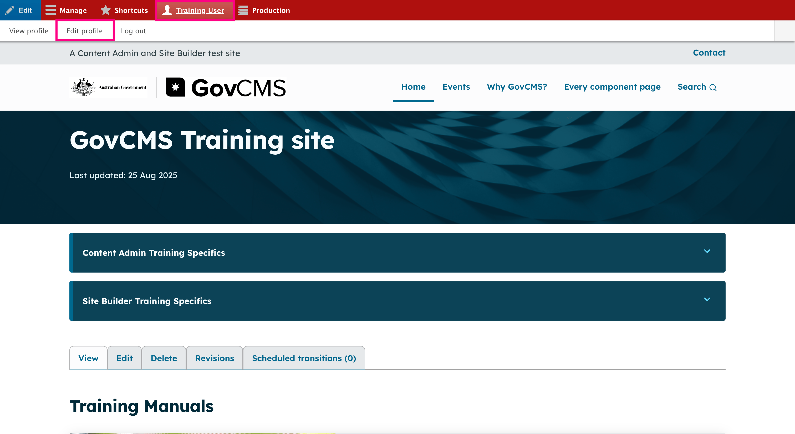
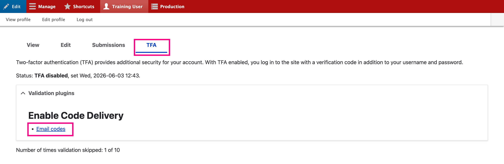
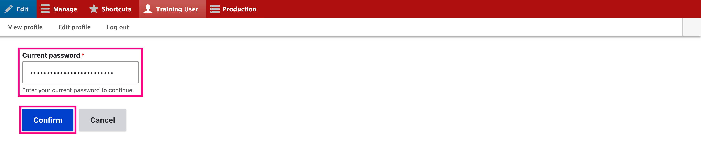
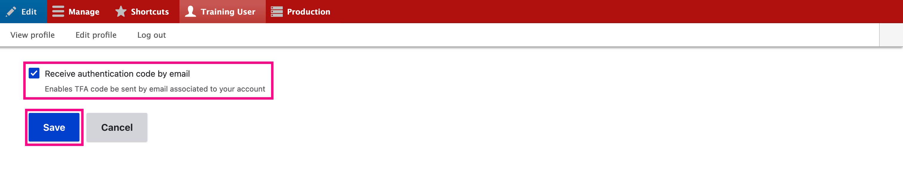
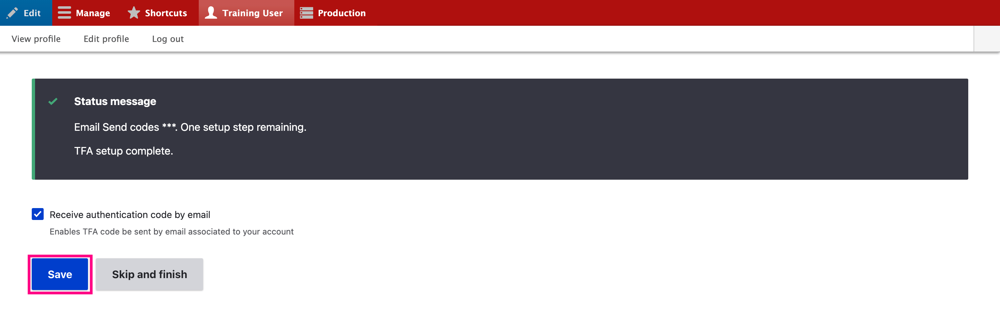
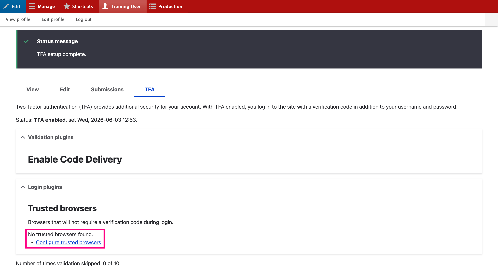
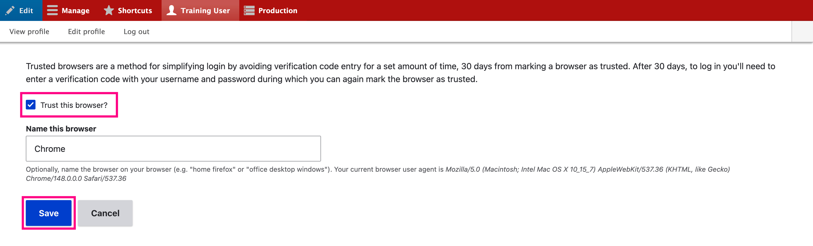

# Two‑factor authentication (2FA)

All websites on GovCMS require **two-factor authentication** (2FA). This is to prevent unauthorised access by people who may steal or obtain a username and password.

Traditional 2FA is setup using a QR code and a mobile phone application. We have a full guide on how to set that up on the [GovCMS Knowledge Base](https://www.govcms.support/support/solutions/articles/51000048926).

This section of the user manual will show you how to setup your 2FA for the GovCMS training environment, which uses email and browser trust instead of the phone application method.

1. Once logged in, click on your name in the Admin toolbar, and then on **Edit profile**.

<figure><figcaption></figcaption></figure>

2. Click on the **TFA** tab, and then on **Email codes**.

<figure><figcaption></figcaption></figure>

3. The next screen will ask for your **current password**. Enter it and select **Confirm**.

<figure><figcaption></figcaption></figure>

4. Check the box **Receive authentication code by email** and then select **Save**.

<figure><figcaption></figcaption></figure>

5. The next screen will provide a confirmation message. Select **Save** to continue.

<figure><figcaption></figcaption></figure>

6. You'll be presented with a screen that will provide you the option to **Configure trusted browsers**. This is an optional step but it's _recommended_ to check this box if you want to bypass TFA the next time you log in using the same device.

<figure><figcaption></figcaption></figure>

7. Select **Configure trusted browsers**. Enter your password on the following screen and select **Confirm**. 
8. Ensure the **Trust this browser** option is checked and select **Save**.

<figure><figcaption></figcaption></figure>

8. Your TFA is now configured.

### What happens if you choose not to **Trust this browser**?

After logging in, you'll be presented with the TFA page. Click on **Send** to receive an email to your account's email address. The email will contain a code that you'll need to copy and paste into the website to confirm your access.


If you do not click on **Send**, no code will be sent to your email.

