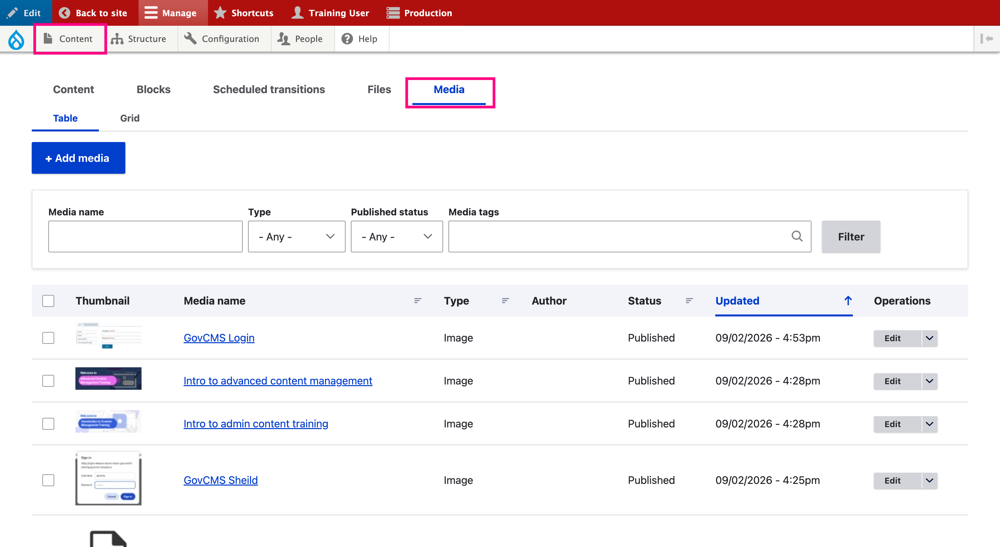

# Adding media


The page has a video that explains the information located at the bottom of the page.


There are two ways to add media to a GovCMS/Drupal website.


Before you upload any files to your website, please be sure to review the filename. Tips:

* Use short but descriptive names
* Replace all spaces with hyphens
* Remove any internal versioning indicators such as \_v1.2-final.&#x20;


### Upload via the Media Library

The easiest way to add media to your website is via the **Media Library**. This can be accessed by clicking on **Content** and then **Media** in the Admin toolbar.

<figure><figcaption></figcaption></figure>

From here, select the **Add media** button in the top left.

Select the **media yype** you'd like to add (similar to how you selected the content type when adding content).&#x20;

In this example we'll upload an **Image**.  Each media type has its own fields and restrictions.

<figure><figcaption></figcaption></figure>

In this example, we're creating an image media entity that has two mandatory fields, **Name** and **Image**.

After entering in a **Name**, use the **Choose file** button and select the file you want to upload.

Once the image is uploaded, you'll then be prompted to provide the **Alternative text**. This is the text that's presented to visually impaired users and is mandatory for your content to meet accessibility standards.

<figure><figcaption>
An Image meda entity with the minimum fields filled in
</figcaption></figure>

Once you've filled in all the fields, select the **Save** button at the bottom of the page.

You'll be returned to the **Media Library** and you'll see the new media entity in the list. This image can now be embedded anywhere on the site.

<figure><figcaption></figcaption></figure>

### Upload media while editing content

Alternatively, you can upload media as required when you're editing content.

If we return to the page we created earlier and scroll down under **Appearance** to the **Thumbnail** field, you'll see an **Add media** button.

<figure><figcaption></figcaption></figure>

Clicking the **Add media** button opens the **Popup Media Library**, which is a slightly stripped-down version of the standard Media Library.

<figure><figcaption>
Popup Media Library with the ability to add new media or select an existing item
</figcaption></figure>

Here you can either create a new image media asset by uploading a file at the top of the popup, or simply select an existing media asset from the grid at the bottom and click the **Insert selected** button.

If we select the **Choose file** button at the top, and select a new file, you'll be presented with a minimal version of the **Add image form** with the **Name** and **Alternative text** fields required.

<figure><figcaption></figcaption></figure>

After entering the correct information and selecting **Save** you'll be taken back to the Media Library popup with your newly uploaded media asset selected.

Click on **Insert selected** to use this media asset.

<figure><figcaption>
When a media entity has a blue outline, it's selected and will be added to your field
</figcaption></figure>


Media added in this method is still available via the main Media Library and can be edited there if required.


### 🎥 Videos



Video transcript

Welcome to the GovCMS Introduction to Content Management series.

In this video, you will learn how to create media assets from the Content Edit Form.

We'll cover the following topic: How to create and reuse assets directly from the Content Edit Form,

So far, we've looked at how to create assets from this media page. You know how to create individual ones by clicking on Add Media, and how to bulk upload them using the bulk upload feature. Now let's look at how to upload and manage assets directly from the Content Edit Form, because this is honestly how you'll manage most of your assets by uploading them while content is being created.

Let's go ahead and create a standard page. So click on Content, then Add Content, and then click on Standard Page, and I'll enter in "About Us" into the title field.

On a standard page, an asset can be created or selected via the thumbnail, attachments, or featured image fields. Now your standard page content form could look a little different. You could have more or fewer fields, But the out-of-the-box standard page should have a thumbnail field for selecting images that will be used for the page thumbnail, and attachments field, where you can select which files will be listed at the bottom of the page. Only document file types such as PDFs or Word documents can be uploaded, and a featured image field, which lets you add a featured image at the top of the page.

Let's go ahead and add a featured image. Click on "Add media" on the featured image field. From the pop-up, you can see all of the existing image media assets, and you can also filter by name and sort the list.

If you want to reuse an existing asset as the featured image, just select it by checking the checkbox, then click on "Insert selected".

But in this example, let's go ahead and upload a new image. Scroll up to the top and here, you can upload an image by clicking on Select Files or by simply dragging a file into this region. Let me go ahead and find my featured image and I'll click on it and then drag it across. And then I'll enter in a name for this media asset. I'll enter in Standard Page Featured and I'll also copy the name over as the alternative text. And then I'll click on Save. Then click on "Insert selected".

At this point, we have uploaded the file, created the media asset and attached it to the featured image field. And if we go to the media page, we should see the asset we just created. If we click on Content and open it up in a new tab and then go to Media, here you can see the asset that we just created.

Let's go back to the Standard Page and make sure we have a title and also a featured image. Then scroll down select "needs review" and click on Save. And here we can see our featured image on the Standard Page.

If you want to change the featured image, click on Edit. And then scroll down to the featured image field and then click on the Remove icon. This will not delete the asset. It will simply remove it from this field and no longer be used as the featured image. But it won't delete the asset, so it's safe to click on Remove.

Let's add another featured image, click on "Add media". And this time, let's find the featured image example. And we can do that by entering in Featured Image into the Name field and then click on Apply filters. And here is the image that I want to use. And we can select it by checking the checkbox and then click on "Insert selected.

And if we scroll down, and change it to "Published"... ...then click on Save, we can see the new featured image. And this asset can be used on multiple pages.

Let's go back and edit the About Us page one last time, so click on Edit. Now, creating or selecting a media asset on any of the three fields; Thumbnail, Attachments and "Featured Image" is exactly the same way. The user interface is the same.

If we click on Add media on the Thumbnail field, we have the "Add file" section above, where you can upload files... ...and below, you can filter and select images.

If we were to click on Add media on the Attachments field, we have the same interface, we can upload from the "Add files" section and filter and select files below. But on Attachments we can choose different media types by clicking on them on the left hand side.

The difference between the Attachments field and the Thumbnail and Featured Image field is that Attachments allows you to select different media types. Whereas the other two fields, Thumbnail and Featured Image, will only allow you to select or upload an image.

Let's now recap what we covered in this video. You learnt how to create and reuse assets within the Content Edit form.



Video transcript

Welcome to the GovCMS Introduction to Content Management series.

In this video, you'll learn how to create media assets and upload files.

We'll cover the following two topics: How to create a media asset How to bulk upload images and PDFs

Now that you have a good understanding of how media is stored in GovCMS, let's go ahead and create a media asset. Assets can be created in two ways: First, you can create one by clicking on "Add media" on this page Second, you can create an asset from one of the media fields on a content type, such as the standard page. But let's create an asset from this page.

To begin, click on add media and now you need to select a media type.

GovCMS comes with these five media types out-of-the-box: First, we have Audio — this allows you to upload audio files such as an MP3 or WAV file. Then we have the Document media type — you'd use this to upload PDFs, Word documents or spreadsheets. Then there's the Image media type — this is used to upload images, such as PNGs, GIFs, or JPEGs, and it'll be the most used media type. Then there is the Remote video media type — this allows you to embed videos from YouTube or Vimeo. And finally, you have the Video media type — which will let you upload a video file such as an MP4 file into the site.

Instead of uploading the video directly into the site using the Video media type, we do recommend that you host your videos on a proper video hosting platform like Vimeo or YouTube and simply embed them using the Remote video media type. Your users will get an improved video player which works on all devices and it's just a better all-round experience.

So let's go ahead and upload an image. To do that, click on image... Enter in the name of the media asset in the name field. We'll call it Featured image. And then click on choose file and select an image... or you can simply click and drag a file. And make sure you give it an alternative text. I'll enter in featured image. And then click on save.

And here you can see the image we uploaded with a nice resized thumbnail. And if we click on the name, we are redirected to the edits page, we can change the name or the alternative text.

One thing I do want to mention is that if we click on add media, then document... ...and we try and upload an image into the file field, we will get a message which will tell us that the file cannot be uploaded. This is because the file field on a media asset only allows certain file types or extensions. You can see below the field which extensions are allowed. And in this example, we can not upload a JPEG because it is not an allowed file type. If we were to go back and then click on audio, you can see that we can only upload an mp3 file, wave, or aac

We've looked at how to create a media asset with a single file. But what if you want to bulk upload a bunch of files at the same time, we can do that by clicking on the "Upload media in bulk" button.

Please note: if you can't see the "Upload Media in Bulk" button, it means you do not have the Media Bulk Upload Module installed. Please contact your development partner and get them to install and configure the "Media Bulk Upload" module.

You can bulk upload files by clicking on select files, or you can simply drag the files into this region... ...wait for the files to upload, and then click on submit. Then you should see a status message mentioning how many media assets were created.

And if you go to content, media, you should see the two media assets that were just bulk uploaded. So if you need to upload 10 images in a single go, then use the bulk upload feature in GovCMS.

Let's now recap what we covered in this video. First, we looked at how to create a media asset. And then you learned how to use the bulk upload feature in Gov CMS.

