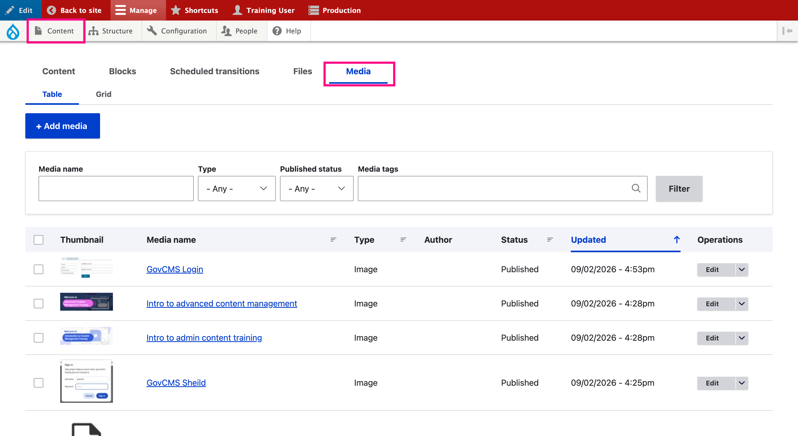

# Working with media and files

An important feature of any content management system is the ability to create and manage media assets such as images, videos, documents, PDFs and other files. GovCMS allows you to upload and manage media assets that can be reused throughout your content.

You can access the **Media Library** by selecting **Content** and then **Media** from the Admin toolbar.

<figure><figcaption></figcaption></figure>

