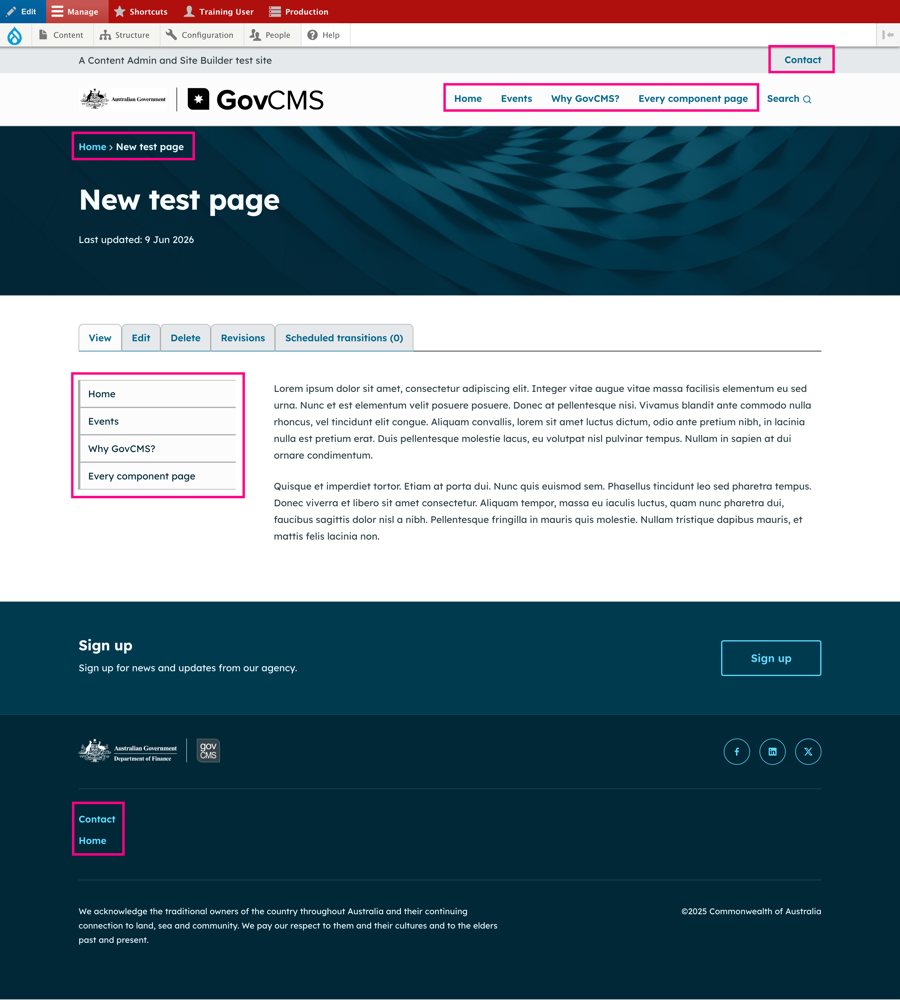

# Overview


The page has a video that explains the information located at the bottom of the page.


There are several different types of site navigation available on GovCMS websites.&#x20;

The GovCMS training website has the following menu and navigation elements:

* **Secondary Navigation**
  * The **Contact** link in the header is the secondary navigation menu
* **Primary Navigation**
  * With links such as **Home** and **Events**, this is the primary menu structure for our pages
* **Breadcrumbs**
  * This shows the current page relative to its location in the overall site structure
* **Sidebar Navigation**
  * This is the primary navigation again in a more accessible location
* **Footer Menu**
  * **Contact** and **Home** in the dark blue area at the bottom are in the footer navigation. This is traditionally where links to **Privacy** and **Security** would be located.

<figure><figcaption></figcaption></figure>

### Other navigation types

Other types of navigation include:

* A sitemap
* Breadcrumbs
* Sidebar ‘blocks’ with links to sub-pages
* Featured links that show a curated list of links relevant to the page the user is currently viewing
* ‘Go back to’ links that take the user back to the parent page in the navigation hierarchy
* Back to top links that appear when the user scrolls down.

The GovCMS training website features only one level of navigation/menu structure. However, GovCMS allows for up to nine levels within the menu system.


Web best practice suggests no more than three levels of navigation should be used if possible.



While the GovCMS training website uses fairly standard list menus, menus can be developed and extended to include dropdown, slide-out or even mega-menu layouts.



Major menu restructures should be escalated to your developers or advanced content editors.

Avoid major restructures or creating new top-level menu items without approval.


### 🎥 Video



Video transcript

Welcome to the GovCMS Introduction to Content Management series.

In this video, you will learn how to manage your site navigation in GovCMS.

We'll cover the following two topics, how the site navigation works and how to manage it, and how to create and edit menu items.

Good site navigation and information architecture play an important part in building a useful website. If you have great information but things are hard to find, then your website's usability isn't good. GovCMS allows you to control and manage the main site navigation from the back end.

On the homepage, we have the main navigation, which is in the header. The footer navigation is at the bottom. Both the header and footer navigation will be displayed on all front end pages.

Let's go to a page. Click on News and Media, then click on the first page. You can see the main navigation in the header at the top here. And the footer navigation in the footer region. Plus, the navigation here is also displayed on the right hand side.

The navigation on your website will look different and could be in different regions. For example, the sidebar navigation could be on the left. The navigation is often customized for each GovCMS website because each website will have different information architecture. Pages also have a breadcrumb just below the main navigation, which helps users navigate between pages.

If we click on the news and media link in the breadcrumb, it'll take us to the news and media landing page.

If we click on blog in the main navigation, then click on a blog article. We can see the breadcrumb on the page, and we can go back to the blog listing page by clicking on the blog link.

So we've talked about the site navigation and breadcrumb in general. Now let's look at how you can manage menu items in the navigation. First, make sure you have the site administrator role as it's required to manage menus. If you need this role, please liaise within your organization and raise a service desk ticket.

To manage the header and footer navigation, go to structure, then click on menus. And here you can see all the available menus. Main navigation is the menu that's displayed in the header region. And footer is the menu displayed in the footer region. Administration, tools and user account menu shouldn't be touched as they are used by Drupal. But the two important ones are main navigation and footer.

Let's go ahead and click on edit menu on main navigation. You can do a few things from this page. First, you can reorder menus. So let's say we want to move the events menu so that it's below home. All we need to do is click on this handle and click and drag it up. Let me go ahead and open up the homepage in a different tab. Here you can see the order, home, blog and events. If we go back to main navigation, you can see the new order will be home, events and blog. If we save it, and then go back to the other tab, and refresh, you can see that the order has been changed. It's now home, events and blog.

Let's go back to the main navigation menu items. You can also hide menu items from this page by enabling and disabling them. Simply uncheck the enabled checkbox. Let's go ahead and uncheck enabled on events, and then scroll down and click on save. Then, let's go back to our other tab, and here you can see the events menu item, but if we refresh, the menu item is no longer there.

However, the page is still accessible. We can still access it by going directly to slash events. So just remember, disabling a menu item doesn't hide the actual page. Users could still go directly to the page if they know the URL.

We've looked at how to manage menu items from this page. You know how to reorder them and also how to hide them by enabling and disabling them. Now let's look at how to create and edit menu items.

To create a menu item, click on add link. Let's add a menu item for the copyright page. Enter a title into the "menu link title" field, and I will enter in Copyright. Then in the link field, which is an auto complete field, you can start typing in copyright and it should find the page, once you have the correct page, select it. Then in the description field, I will enter in copyright page. This description will appear when you hover over the menu. Make sure the parent link has main navigation selected. This should be pre populated. So leave it as it is and then click on save.

If we scroll down, we can see the copyright page at the bottom. If I open up the homepage in a new tab, we can see the copyright menu item. And if we click on it, we get redirected to the copyright page.

Now, let's go back to the menu items To edit any of these menu items, simply click on edit, make your change, and then click on save.

To delete a menu item, click on the down arrow, and then click on delete. You can also delete the menu item by editing it first and then clicking on this delete button next to save.

You may notice that some menu items do not have a delete button, and the homepage just has a reset button. In the case of the homepage menu, it's automatically created, so it can't be deleted from this page. If you don't want the home menu item, simply disable it.

The other four menus, blog, events, FOI requests and news and media, are controlled by a module in GovCMS. The only thing we can do is change the menu title. If we edit the blog menu, we can change the title and the description, but we can't change the link. And it tells us this link is provided by the views module. If you do not want the blog menu item or any four of these menu items, then simply disable them. Other menu items, created using the add link form, can be deleted.

We've looked at how to manage menu items from this listing page. Now let's look at how to create a menu item from the content edit form. When you're creating a standard page, you can create a menu item for it.

Let's create a new page. Click on content, add content and click on standard page. I will enter "Menu item page", as the title. I'll also paste some random text into the body field. On the right hand side, you should see a menu settings field. Click on it and then click on provide a menu link. The menu link title will automatically be pulled from the page title. You can also add in a description and a weight value. The weight value controls the order of the menu.

From the parent item drop down, you can select the menu that the new content will be part of. You can also select another menu item to be its parent. The number of parent items you can select can be configured. So on your GovCMS website, you may have more or fewer items to select.

Let's leave it set to main navigation. Then scroll down and set it to needs review. And publish the page. In the main navigation, you can see the menu item we just created.

Let's go back and edit the page. Now I want to discuss some limitations with this interface. Firstly, you can't see any of the other menu items. This makes it difficult to reorder the item. You can add a weight value, but you're guessing what the weight value should be. When you're creating a new page, I recommend creating the menu item by checking provide a menu link and then publishing your page.

Then go to structure, menus, then edit menu. You can then reorder the menus from here.

Let's now recap what we covered in this video. First, we looked at how the site navigation works and how to manage it. Then you learn how to create and edit menu items.

