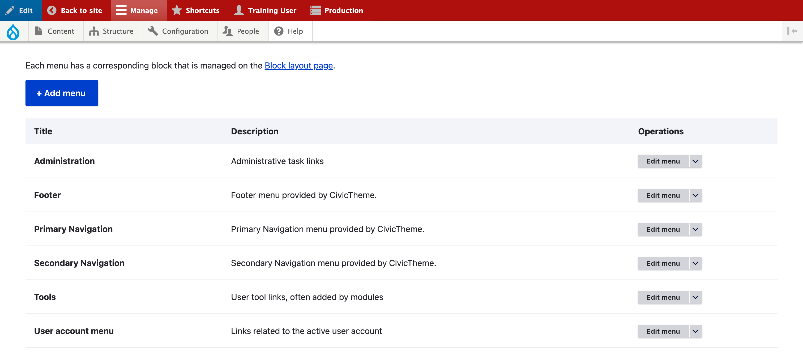
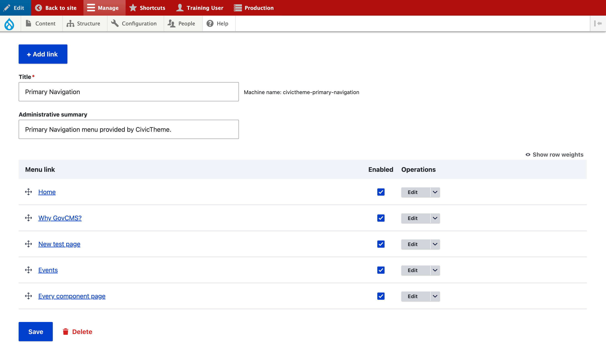

# Using the menu screen

In addition to editing or adding menu items by editing their associated pages, you can also edit menu items via the **Menu administration** screen, which is accessible via **Structure** and then **Menus**.

<figure><figcaption></figcaption></figure>

Each menu serves its own purpose:

* **Administration:** The internal **Administration menu** located at the top of the page
* **Footer:** A menu designed for links that appear in the footer of the website
* **Primary Navigation:** The main navigation menu for the website
* **Secondary Navigation:** For non-critical links such as Contact or About
* **Tools:** A default menu added by Drupal, not used
* **User account menu:** A menu specifically for users, not used in government

There's also an **Add menu** button located at the top of the page, allowing you to add as many custom menu containers as you like. However custom menus can't be used with content types until configured correctly by your developers.

### Editing a menu

If you select **Edit menu** beside the **Primary Navigation** you can see a list of all the links in the menu.

When editing a menu directly like this you can:

* Add new links
* Disable or remove links
* Edit a link name or destination
* Reorder links

<figure><figcaption></figcaption></figure>

#### Add a link directly

To add a link, select the blue **Add link** button at the top of the screen and you'll be presented with a form to add a new menu link.

<figure><figcaption></figcaption></figure>

* **Menu link title** is the text that will appear as the menu link.
* **Link** is an autocomplete field where you can type in the title of any page internally and select it, or enter in the full URL of an external website.
* **Parent link** on the right-hand side will allow you to select the position in the menu
* **Display settings** includes the weight option.
* **Description** is a text field that will display help text when a user hovers over your link.

Once you've completed the mandatory fields, select **Save** to save your menu item.

You'll be returned to the **Menu screen page**, and your new link will be added to the menu.

#### Reordering menu links

While the value entered into the **Weight field** will determine the original position of the menu item, you can easily reorder the items in the list using for the 4-arrow widget next to each menu entry.

Simply **click and drag** the item to reorder your menu.


If you don't see the 4-arrow widget, instead you may have a column that says "Weight" showing a select list. You can toggle the visibility of the list and the widget using the **Show/Hide row widgets** button located on the top right of the table.


When you click and drag an item, an asterisk will appear on the row, along with a message at the top that says you have unsaved changes.

To save your changes, scroll down and select **Save**. To abandon your changes, simply navigate away from the page or refresh.

<figure><figcaption></figcaption></figure>

#### Creating child items

You can also drag items horizontally to set the page to become a child of a parent page.

In the example above, all pages are at the same, top level. However, in the example below the **New test page** is now a child page under the **Why GovCMS?** page.

<figure><figcaption></figcaption></figure>

#### Disabling menu items

You can also disable menu items by unchecking the **Enabled** button and selecting **Save**.

This can be handy if your website structure and display is determined by your menu structure, but you don't want specific pages to be displayed in the menu itself.
