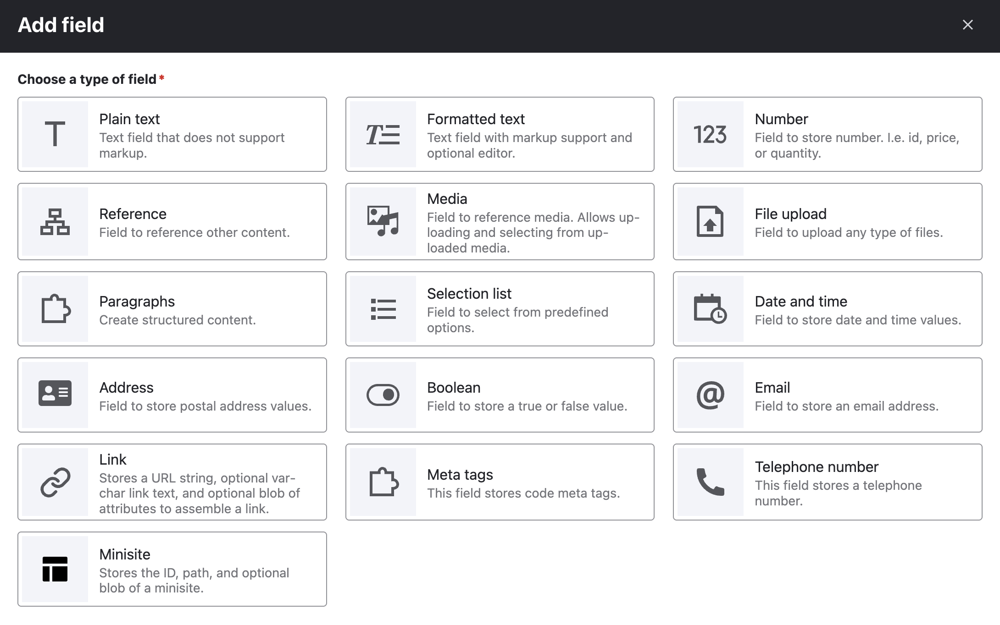

# Fields

GovCMS comes with a number of available field types. Each field type has its own limitations and validation options. While we don't cover adding new fields to content types in Introduction to Content Management, it's important to know what fields are available to your website.

<figure><figcaption>
The various Fields available in GovCMS
</figcaption></figure>

### Plain text

Standard unformatted text field. Can be either single line like a title, or multi-line like a summary field.

### Formatted text

A multi-line text field with a [WYSIWYG editor](https://app.gitbook.com/s/zAp101XNX82HnyCe3C9U/rich-text-editing-with-ckeditor-5). This is used for the majority of text-based content.

### Number

A field that only accepts a number. It can also be configured to hold decimal numbers, as well as have set increments.

### Reference

Reference is used when you need to reference other content inside your website, such as taxonomy terms, or if you want to link two pieces of content together.

### Media

The [media](https://app.gitbook.com/s/zAp101XNX82HnyCe3C9U/media-and-files) field type is used for all media that's uploaded (e.g. images, video, documents) and can even be used to create references to YouTube or Vimeo videos.

### File upload

File upload is a legacy field that should not be used in content types.

### Paragraphs

Paragraphs is the reusable content templates sometimes known as components. While individual paragraphs are configured elsewhere by developers, this field type is how they're added to a content type.

### Select list

A predefined dropdown list of items.

### Date and time

Allows users to select a date, time or date and time. Great for events.

### Address

The address field provides a prebuilt set of fields that can be used for street, state, postcode, etc. It does **not** include the common functionality of an address lookup.

### Boolean

Booleans are simple true/false options.

### Email

Like a the simple text input field, except has an additional validator that ensures the field contains an email address.

### Link

Link can be used for any internal or external link. You can link between content inside your website with a title-based autocomplete search, or link to external websites.

### Meta tags

[Meta tags](https://app.gitbook.com/s/zAp101XNX82HnyCe3C9U/metatags-and-seo) are added automatically to all content types. You do not need to add them manually.

### Telephone number

Similar to the email field, this field is a standard text input field, but with validation for phone-number formats.

### Minisite

Minisite allows you to upload a zip file that contains a standalone website, which gets served from your GovCMS website.
