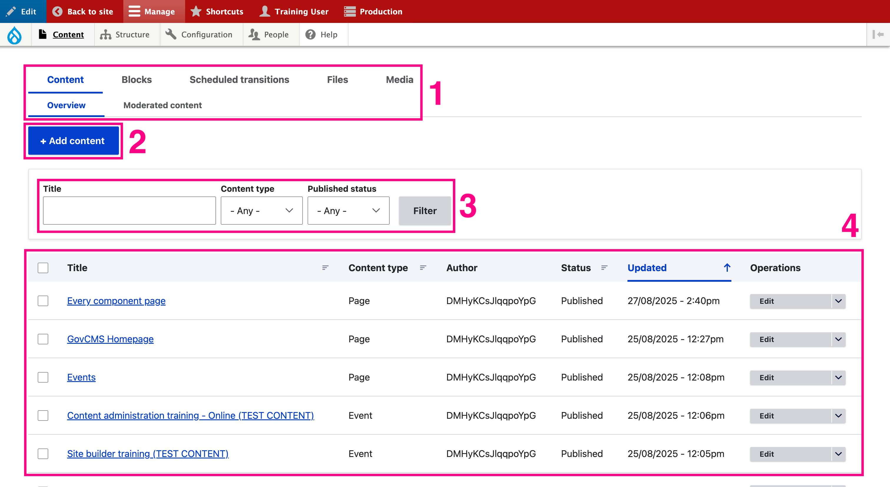

# Using the content screen


The page has a video that explains the information located at the bottom of the page.


The primary area you'll use is called **Content.** You can access it by selecting **Content** in the **Admin toolbar**.

<figure><figcaption></figcaption></figure>

The page consists of a few different elements:

1. Top navigation
2. Add content
3. Filter content
4. Content table
5. Bulk actions

<figure><figcaption>
Bulk actions are visible at the bottom of the page, below the screenshot area
</figcaption></figure>

### Top navigation

The top of this page contains a menu to the main content areas of the website:

* Content
  * Overview
  * Moderated content
* Blocks
* [Scheduled transitions](../workflows/scheduled-publishing.md)
* [Files](../media-and-files/media-vs-files.md)
* [Media](https://app.gitbook.com/s/zAp101XNX82HnyCe3C9U/media-and-files)

For now we'll focus on Content (the other areas will be covered in later topics).

### Add content

Below the navigation tabs is the **Add content** button. Selecting this button will take you to a page where you can choose the content type you'd like to use for your new content.

### Filter controls

Below that is the filter area, with the default filters you can use to filter content on your website. This can be handy when you're looking for a specific piece of content and your website has hundreds of content items.

By default the filters are:

* Page title
* Content type
* Published status

However, your developers can change these and add extra filters if required.

### Content table

Under the filter area is the content table. This table shows all node content of your website in a table showing:

* Title
* Content type
* Author's name
* Published status
* Last updated
* Operations

To view a piece of content, simply select the **page title** link in the first column.

To edit a piece of content, select the **Edit** button from the **Operations** column on the far right.

### Bulk operations

Similar to the People page, each content row has a checkbox that allows you to perform the same action across multiple pages at once.

Available bulk operations are:

* Delete content
* Make content sticky
* Make content unsticky
* Promote content to front page
* Publish content
* Save content
* Remove content from front page
* Unpublish content
* Update URL alias

However, since content should never be deleted from a government website, and most websites don't use the "sticky" or "promote" features, it's like you'll only use:

* Publish content
* Unpublish content

This feature can be useful when archiving entire sections of a website. However these bulk operations are not used very often on production websites.

### 🎥 Videos



Video transcript

Welcome to the GovCMS Introduction to Content Management series.&#x20;

In this video, you'll learn how to access the content management area where you can create and manage your GovCMS content.&#x20;

Make sure you are logged into your GovCMS site and that your user account has the content author or site administrator role.&#x20;

If you don't have the content author or site administrator role, please liaise within your organization and raise a service desk ticket.

You should see the admin toolbar right here. Make sure the Manage section is expanded, and then simply click on Content.

And now you should see the content management area.&#x20;

You'll notice straight away that the style has changed, and that's because we are now in the back end of GovCMS.&#x20;

An admin interface is used for the GovCMS back end.&#x20;

Whenever you have to manage content or change a configuration, you'll do so using the admin interface.



Video transcript

Welcome to the GovCMS Introduction to Content Management series.&#x20;

In this video, you'll learn how to filter content in the content management area.

In the previous video, you were introduced to the content management area where you can create and manage content on your GovCMS website.

Now I want to show you how to filter content on the page. Using these exposed filters, you can filter your content by title, content type, and publish status, if it's published or unpublished.&#x20;

If I add a keyword into title, such as example, and click on Filter, it'll return all content with that keyword in the title. But we can drill down even further by selecting a content type.

If I select Event from the content type dropdown and click on Filter again, it'll return all events with this keyword in the title.

This makes it very easy to find any specific content. If you want to clear the filter, just click on Reset.



Video transcript

Welcome to the GovCMS Introduction to Content Management series.&#x20;

In this video, we'll take a deeper look into the content management area.

We'll cover the following two topics. You'll learn about the different sections in the content management area, and you'll learn how to access the files and media pages.

This is the content management area where you can create and manage content in your GovCMS website. To access this page, make sure you're logged in and you have the content author or site administrator role.&#x20;

If you don't have the content author or site administrator role, please liaise

within your organization and raise a service desk ticket.&#x20;

Click on Manage in the admin toolbar if it's not expanded, then click on Content.&#x20;

Below the page title right here, you have three navigation options or tabs: Content, Files, and Media.&#x20;

We are currently on the Content tab, that's why it's active.

But if we click on the Files tab, this will take you to a page where you can see all the uploaded files on your website.

And if we click Media, we can see all of the reusable media assets, like videos and images, that have been uploaded to your website.

We'll look at files and media in more detail later in this training series. But now let's go back to Content.

Above the page title, we have the breadcrumb, which tells you where you are within the back end, and it's an easy way to navigate between admin pages.

We also have the Add Content button. Below that is the ability to filter the list of content displayed, which we'll look at in more detail in the next video.&#x20;

Below the filters is a list of the actual website content, sorted by the updated date. Let's now recap what we covered in this video.&#x20;

You learned about the different sections in the content management area.

Then we looked at how to access the files and media pages.

