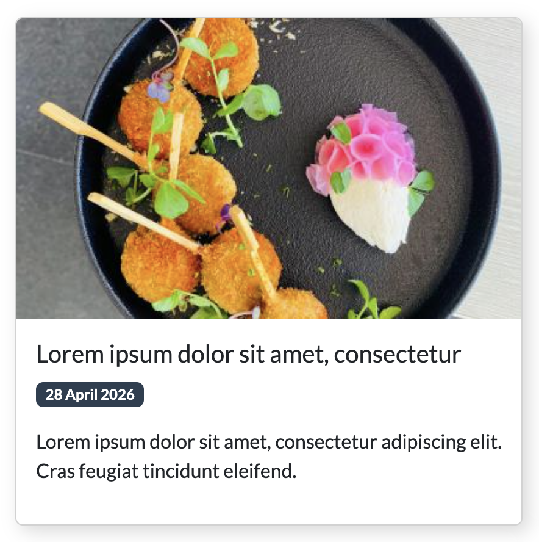
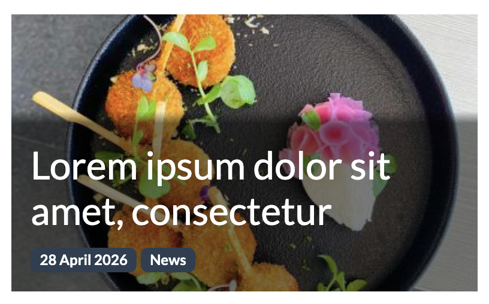
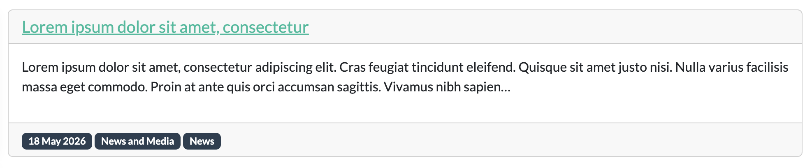

# View modes

View modes allows you to use the same content but have it display differently to the user (using different view modes).

The default view modes are:

* **Full view:** Full page display
* **Teaser:** Short preview used in listings, cards and search.

These can be customised by your developers.

The following example is one news post being displayed in three different view modes.

<figure><figcaption>
News item displayed using the custom News Card view mode.
</figcaption></figure>

<figure><figcaption>
News item displayed using the custom Related News view mode
</figcaption></figure>

<figure><figcaption>
News item displayed as the Teaser view mode in a Search list
</figcaption></figure>
