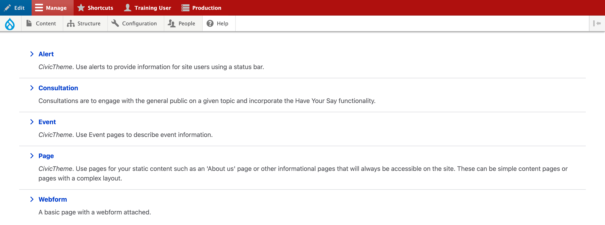

# What are content types


The page has a video that explains the information located at the bottom of the page.


### What are content types?

Content types are Drupal's way of defining a group of similar content, with similar characteristics and structure.

A **content type** is built from a collection of **fields**, and has consistent settings across all content of that type. For example, all standard page content will have the same fields available, and share the same URL structure.

Your developers can define your own content types, however GovCMS comes with some out-of-the-box content types.

### Content types used in GovCMS

GovCMS comes with the following content types out-of-the-box:

* Blog article
* Event
* FOI
* News and media
* Standard page
* Webform

However the GovCMS training website is developed using CivicTheme, and it uses its own array of content types:

* Alert
* Consultation
* Event
* Page
* Webform

You can see the content types by hovering over **Content**, then selecting **Add content**.

<figure><figcaption></figcaption></figure>

### Why use different content types?

Let's look at an example to demonstrate why different content types are useful. Let's consider a **publication** and an **event**.

Events will always have a time, date and location and so the event content type contains these fields. Whereas a publication may not need a time, but would need an author and attachment field. This means two different content types are needed.

In some cases content types can be harder to define or differentiate. For example, a basic page and a landing page may have very similar content, but need a different URL structure.

Defining and structuring your content types is something a developer does, but it's important for Content Authors to know what options are available in GovCMS.

### 🎥 Video



Video transcript

Welcome to the GovCMS Introduction to Content Management series. In this video, you'll learn about content types in GovCMS. We'll cover the following topics.

The default content types that come with GovCMS, and you'll learn about what content types are and how they're used.

The content on a GovCMS website is made up of different content types. GovCMS comes out of the box with five content types, and if we click on Add content, we can see the five content types.&#x20;

Blog article, which is used for basic blog content.

Event, which can be used to promote events. You can specify an event start and end date, and also a location.&#x20;

FOI, or freedom of information. This should be used to display a record of an FOI request.&#x20;

News and media, which is for media releases and news items.&#x20;

Standard page. This content type is used to create general pages like the About Us, Privacy Policy, or any type of generic page.

These are the five out-of-the-box content types that come with GovCMS. On your site, you may have more content types, as it is common to create custom ones.&#x20;

But on most GovCMS sites, you'll see at least these five. Before we move on, let's discuss what content types are.

Content types are a useful way to group similar content with similar characteristics. It means people can talk about sets of content, for example, events, and it's also a way to set up a common template across a type.&#x20;

Let's go ahead and click on Event and look at this content type, for example.

Events will always have a time, date, and location, and so the event content form contains these fields right here.&#x20;

Whereas other types of content, such as standard page, won't include this information, so they won't have a time, date, or location field.&#x20;

Another way to think of it from a technical standpoint is that content types bundle together fields such as thumbnail, body, attachments, and so on.

