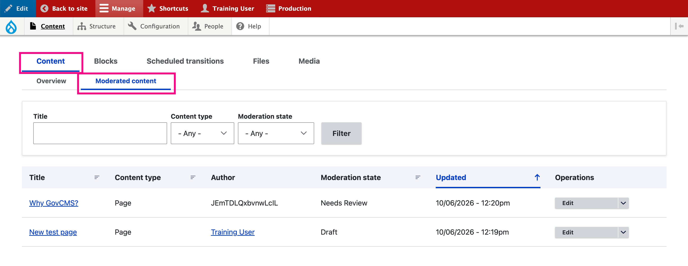

# Moderation dashboard

The GovCMS content moderation module also provides a customisable dashboard. To access the content moderation dashboard click on the **Content** button in the Admin toolbar to navigate to the main **Content Administration** page. Then click on the **Moderated content** tab highlighted in the screenshot below.

<figure><figcaption></figcaption></figure>

Once in the content moderation dashboard, you'll see a list of content that's in different states.&#x20;

In this example we can see the **Why GovCMS?** page is at **Needs Review**, and the **New test page** is in **Draft**.

This page has the same filtering options as the main content page, allowing you to search and filter the results.
